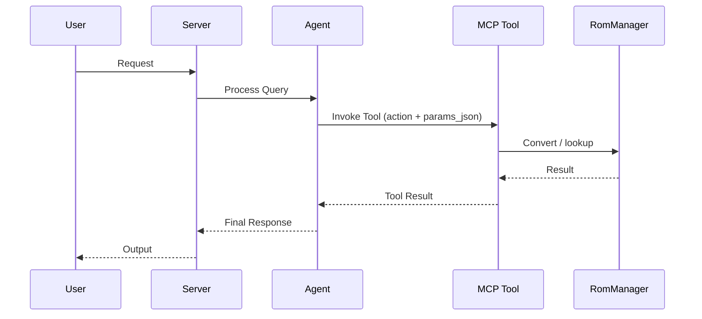

# AGENTS.md

<!-- agent-contract:start -->
## Agent contract

Tool-neutral rules for any AI agent or human working in this repository. This block is maintained by the fleet standard; edit outside the markers.

- **Owner boundary:** this repository owns one external system's calls, mappings and MCP tools (spec prefix `CONN-ROM-MANAGER-`); it depends on the connector SDK only. Feature routing across repositories: [ecosystem boundaries](https://github.com/Knuckles-Team/pipelines/blob/main/reference/ecosystem-boundaries.md).
- **Setup:** run `uv sync --locked`, then `uvx pre-commit install --hook-type pre-commit --hook-type pre-push`.
- **Gates:** `uvx pre-commit run --all-files` must pass before you push. Do not bypass hooks to get green.
- **Commits:** one logical change per commit with a `Spec: <ID>` trailer (or `Spec: none (<reason>)`), plus a `Co-Authored-By:` trailer naming the assisting agent. Stage explicit paths only; never `git add -A` or `git add .`. Use your own configured Git identity, never a tool or bot name.
- **Org rules:** [organization AGENTS.md](https://github.com/Knuckles-Team/.github/blob/main/AGENTS.md).
<!-- agent-contract:end -->

> Canonical guidance for any AI coding agent or human; tool-specific entry files
> (for example `CLAUDE.md`) only import this file. Edit this file.

## Tech Stack & Architecture
- Language/Version: Python 3.11+
- Core Libraries: `agent-connector-sdk`, `fastmcp`, `pydantic-ai`, `tqdm`, `requests`
- External binaries (runtime, for conversion): `chdman` (mame-tools), `dolphin-tool`, `7z`/`patool`
- Key principles: Functional patterns, Pydantic for data validation, asynchronous tool execution.
- Two domains, one tool: the **local** pipeline operates on ROM files already on
  disk (extract/convert/rename); the **RomM** client (CONCEPT:RO-OS.state.api-base-one-mixin) talks to a
  running RomM *library server* over its REST API. Both are exposed through one
  `rom-manager` CLI, one MCP server, and one agent.
- Architecture:
    - `rom_manager/rom_manager.py`: The real ROM conversion pipeline (`RomManager`) + the **unified CLI** `rom_manager()` (legacy convert flags + `convert`/RomM subcommands).
    - `rom_manager/mcp_server.py`: MCP server entry point and tool registration.
    - `rom_manager/mcp/`: Action-routed MCP tool modules (`mcp_conversion.py`, `mcp_game_codes.py`, `mcp_romm.py`).
    - `rom_manager/api_client.py`: Honest local facade (`Api`) over `RomManager`.
    - `rom_manager/auth.py`: Local/no-op config factory (`get_client`).
    - `rom_manager/romm/`: RomM remote-library integration (CONCEPT:RO-OS.state.api-base-one-mixin) — `api/` (base + one mixin per resource → `RommApi` facade), `auth.py` (`get_romm_client`), `cli.py` (RomM subcommands), `openapi.json` (vendored spec, parity guard).

### Architecture Diagram

### Workflow Diagram


## Commands (run these exactly)
# Installation
pip install .[all]

# Quality & Linting (run from project root)
pre-commit run --all-files

# Execution Commands
# rom-manager        -> CLI converter (rom_manager.rom_manager:rom_manager)
# rom-manager-mcp    -> MCP server (rom_manager.mcp_server:mcp_server)
# preferred — repository-manager MCP:
rm_worktree add <repo> <your-branch>      # -> ${WORKTREE_ROOT}/<repo>/<your-branch>

# raw-git fallback:
git -C agent-packages/<repo> checkout main
git -C agent-packages/<repo> worktree add ${WORKTREE_ROOT}/<repo>/<branch> -b <branch>
```

Work in the worktree and **commit often** (commits survive a working-tree reset).
Each session must use a **distinct branch** — git allows a branch in only one
worktree, which is what keeps concurrent sessions from colliding. Worktrees live
under `${WORKTREE_ROOT}/` (outside the workspace scan, so the sync leaves them
alone).

**Finishing work in a worktree** — run this sequence before calling it done:
1. **Pre-commit green** — `pre-commit run --all-files`; resolve every issue per the
   Quality Bar above (including pre-existing), no `--no-verify`.
2. **Commit** in the worktree.
3. **Merge to main locally** — `rm_worktree merge <repo> <branch> --into main`
   (or `git merge --no-ff`). Push only when the user asks.
4. **Clean up** — remove the worktree and remove the merged branch:
   `rm_worktree remove <repo> <branch> --delete-branch`; `rm_worktree prune` clears
   stale entries. (Raw-git: `git worktree remove <path> && git branch -d <branch>`.)

<!-- BEGIN concept-coordination (generated) -->
## Concept-ID Coordination (multi-session)

Working in parallel with other sessions/worktrees? **Reserve a concept id before you write its `CONCEPT:` marker** so two sessions never collide:

```bash
agent-connector-sdk --json concept reserve --ns EG-KG.compute.backend   # or a package prefix, e.g. KEY
```

Full protocol (ledger, merge=union, reconcile, MCP/REST): <https://knuckles-team.github.io/agent-connector-sdk/concept_coordination/>
<!-- END concept-coordination (generated) -->

## Version & lockfile drift edict (keep the version mirrors AND the lock in sync)

The two most common release-breakers in this fleet are **version drift** (the version in
`pyproject.toml`/`.bumpversion.cfg` advancing while `README.md`, `docker/Dockerfile`, and the
module `__version__`s lag) and a **stale `uv.lock`** (shipping known-vulnerable transitive deps).
A version mismatch makes the next `bump-my-version` throw `VersionNotFoundException`; a stale lock
is what Dependabot flags. Rules:

1. **Never hand-edit a version string.** Change the version ONLY via
   `bump-my-version bump {patch|minor|major}` (a.k.a. `bump2version`), which rewrites every file
   registered in `.bumpversion.cfg` in one atomic, tagged commit. If the operator edited the version in
   `pyproject.toml` by hand, the operator created drift — revert and use the bumper.
2. **Every version-bearing file must be registered in `.bumpversion.cfg`** — at minimum
   `pyproject.toml` AND `README.md`, plus `docker/Dockerfile` and any module `__version__`. Never
   add a file that embeds the version without a `[bumpversion:file:...]` entry for it.
3. **Re-lock on every dependency change.** After editing `pyproject.toml` deps/extras, run
   `uv lock` and commit `uv.lock` in the SAME change. The `uv-lock` pre-commit hook runs with
   `--locked` and fails on drift — never bypass it. The committed `uv.lock` is the
   Dependabot/security surface.
4. **Patch CVEs with a version floor at the source, then re-lock.** `uv` resolves one version
   graph-wide, so a lower-bound in the extra that pulls a dependency raises it for the whole lock.

## Upstream currency edict — target the newest release; a pin is a hypothesis, not a fact (READ BEFORE capping, deferring, or opt-in-gating an upgrade)

This governs how this repository treat **other people's** releases, deprecations, and version caps in
this repo (fleet-wide edict, propagated from `agent-connector-sdk/AGENTS.md`).

1. **Latest by default.** Target the newest upstream release -- including a pre-release
   where the ecosystem has already moved onto it. Sitting on an old major because the
   upgrade is work is not a reason to defer it.
2. **A conservative upstream pin is a hypothesis, not a fact -- test it, don't inherit
   it.** Upstream maintainers cap defensively (an unreleased major, an untested surface)
   as often as they cap for a known break. Worked example (from `agent-connector-sdk`):
   `pydantic-ai-slim` 2.18.0 declared `fastmcp-slim[client]>=3.3.0` with no upper bound;
   2.19.0 added `<4` purely as a defensive guard while fastmcp 4 was still pre-release --
   not because of an observed incompatibility. Blocking an upgrade on that kind of cap
   without testing it is the wrong default.
3. **Forward-fix only.** When an upgrade breaks something, fix the break to proceed --
   do not pin backwards, vendor a fork, or route around it. If a break is genuinely
   unfixable inside this repo, say exactly what and why, and carry a plan to unblock it
   -- never an indefinite pin.
4. **Deprecations are fixed on sight, in code AND in tests.** A `DeprecationWarning` from
   an upstream library is a defect to fix now, not noise to filter. **Never** silence one
   with a warning filter, `# noqa`, or a pytest `filterwarnings` entry to go
   green.
5. **Adopt upstream features rather than reimplementing them.** If upstream ships a
   capability this repo hand-rolled, migrate to theirs and remove the local one.
6. **Nothing built on an upgrade ships opt-in.** A new capability an upgrade unlocks is
   default-on unless it genuinely costs compute, in which case it is policy-selected,
   never flag-gated. An opt-in extra or a dependency-conflict fork is an interim state
   that must carry a written plan to become the default, never a resting place.

## Specs: extend first

Find the spec row that owns the behavior before any code change. Search with `git grep -n "<term>" -- specs`. Cite the row ID in the commit `Spec:` trailer. Extend the owning spec before any new spec text. Add a child row, a new rollup, or a dated `plan.md` "Amendments" entry. Create a new spec only for a capability that no spec owns. Audits, reviews, and carry-overs land in the owning spec. They never get a spec directory. Reuse an existing function, module, or store before adding one. The rules are the ecosystem [spec standard](https://github.com/Knuckles-Team/pipelines/blob/main/reference/spec-standard.md).
